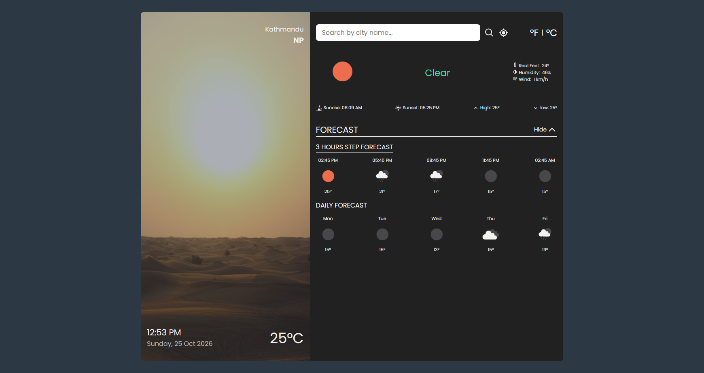
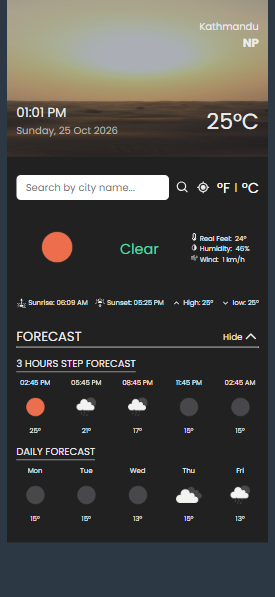

# Weather App

A simple and responsive **Weather Application** built with **React.js and Vite** that provides real-time weather information using the **OpenWeather API**.

Users can search for a city, get weather based on their current location, switch between Celsius and Fahrenheit, and view upcoming weather forecasts.

## Live Demo: https://weather-app-3qm6.onrender.com/

### NOTE:
document of this project is in document folder.

---

## Features

- Search weather by city
- Get weather using current location
- Switch between °C and °F
- View current weather conditions
- View humidity, wind, and feels-like temperature
- View sunrise and sunset
- View hourly and daily forecasts
- Responsive user interface

---

## Technologies Used

- **React.js** – UI development
- **Vite** – Development and build tool
- **JavaScript** – Application logic
- **OpenWeather API** – Weather data
- **Luxon** – Date and time formatting
- **React Icons** – Icons
- **CSS** – Styling

---

## Project Structure

```text
src/
├── assets/
├── components/
│   ├── Display.jsx
│   ├── Input.jsx
│   ├── TempTimeDetail.jsx
│   ├── Forecast.jsx
│   └── ForecastAccordianButton.jsx
│
├── weatherService/
│   └── weatherService.js
│
├── App.jsx
├── main.jsx
└── index.css
```

The project keeps **UI components** and **API/service logic** separate, making the code easier to understand and maintain.

---

## How It Works

```text
User searches a city
        ↓
React updates the search query
        ↓
Weather service calls OpenWeather API
        ↓
Weather data is formatted
        ↓
React state is updated
        ↓
Weather information appears in the UI
```

The same process is used when the user selects their current location or changes the temperature unit.

---

## Environment Variables

Create a `.env` file in the project root:

```env
VITE_API_KEY=your_api_key_here
VITE_BASE_URL=https://api.openweathermap.org/data/2.5
```

Keep the API key private and do not commit the `.env` file to GitHub.

---

## Run the Project

Install dependencies:

```bash
npm install
```

Start the development server:

```bash
npm run dev
```

Build for production:

```bash
npm run build
```

---

## Benefits

This project demonstrates practical knowledge of:

- React components and props
- `useState` and `useEffect`
- REST API integration
- `async/await`
- API data transformation
- Browser Geolocation API
- Environment variables
- Reusable components
- Separation of UI and service logic

---

## Future Improvements

Possible improvements include:

- Loading and error states
- Weather-based backgrounds
- Search suggestions
- Favorite/recent cities
- Air quality and UV information
- Improved mobile experience
- More detailed forecasts
- Dark/light theme

---

## Purpose

The main purpose of this project is to practice **React development and real-world API integration** while building a clean, reusable, and easy-to-understand application suitable for a portfolio and interview demonstration.

---

## Author

**Ritesh Chaudhary**

BSc (Hons) Computing Graduate  
Interested in React, JavaScript, Data Analysis, and Full-Stack Development.

---

# 1. Desktop View



# 2. Mobile View


